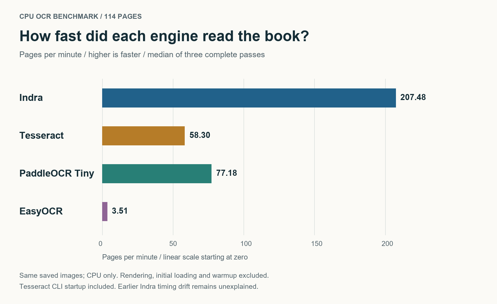
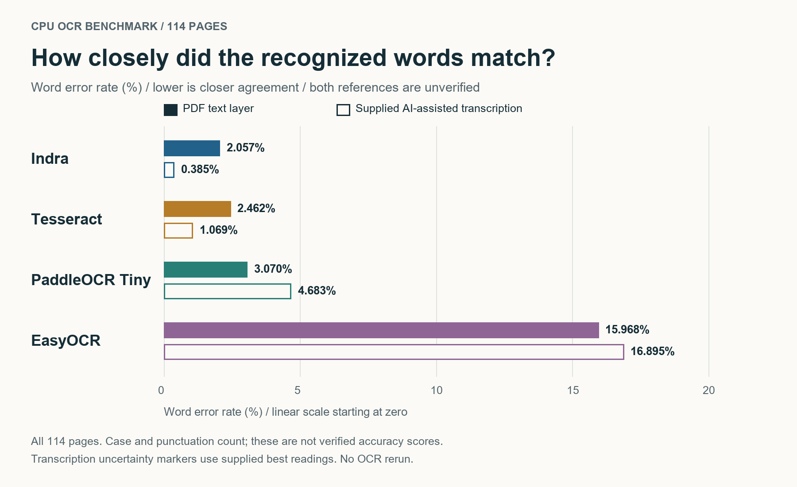
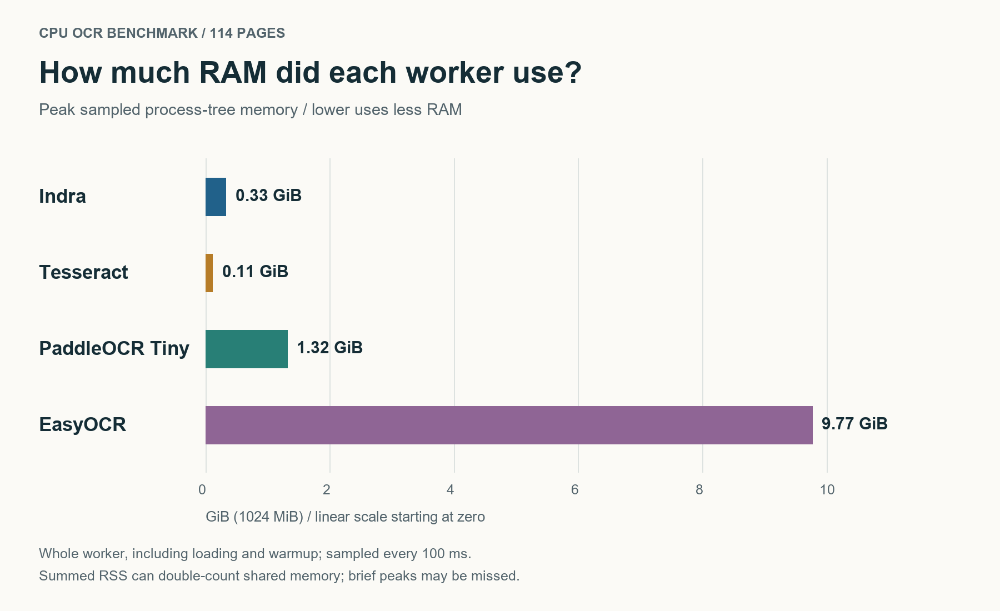

# CPU OCR benchmark: Indra, Tesseract, EasyOCR and PaddleOCR

**114 pages, four engines, three CPU passes each.** Indra led this run on speed and text agreement; Tesseract used the least RAM. These are single-book results against unverified candidate references.

Tested configurations: Indra 0.3.2; Tesseract 5.5.3; EasyOCR 1.7.2 with CPU dynamic quantization; and PP-OCRv6 Tiny via ONNX Runtime CPU.

## Read the results

- [Short visual article](publication/MEDIUM_POST.md) - speed, word-error and RAM charts.
- [Full methods](publication/MEDIUM_FULL_METHODS.md).
- [Four-engine results](publication/cpu-four-comparison.md).
- [Supplied-transcription comparison](publication/transcription-comparison.md).
- [Setup and configurations](docs/CPU_COMPARISON.md).

## Benchmark charts

The same charts used in the Medium draft, rendered from saved results with AI assistance.

### Speed



Higher is faster. Median throughput across three passes; initial loading and warmup are excluded.

### Word error rate



Lower means closer agreement. Both references remain unverified; these are not independently verified accuracy scores.

### Memory use



Lower uses less RAM. Whole-worker memory includes loading and warmup; its scope differs from throughput.

## Repository layout

| Location | Purpose |
|---|---|
| Root `*.py` files | Benchmark, evaluation and reporting tools; kept here to preserve runtime paths |
| `tests/` | Software tests |
| `docs/` | Setup instructions and technical notes |
| `publication/` | Article, charts, current metrics and audit files |
| `archive/` | One frozen evidence package with historical results and source snapshots |
| `eval/config.json` | Non-sensitive text normalization settings |

Local virtual environments, models, book files, raw predictions, caches and working notes are excluded by `.gitignore`. The source PDF and transcription may still exist locally; they are not repository assets.

## Run software checks

From the repository root with the benchmark environment installed:

```powershell
.\.benchmark-venv\Scripts\python.exe -m unittest discover -s tests -p "test_*.py"
```

For benchmark setup, see [CPU_COMPARISON.md](docs/CPU_COMPARISON.md) and [BENCHMARK.md](docs/BENCHMARK.md). Reproducing this book experiment requires the omitted matching input PDF and locally generated data. The scripts are not a turnkey fresh-dataset pipeline. Recorded absolute paths are provenance, not portable download links.

## Scope

Both references remain unverified. Indra's cross-session speed variation is unresolved. This i7-12700K / approximately 96 GiB desktop does not establish results for entry-level PCs or other document types. No new inference measurements were made during repository cleanup.

The article was prepared with AI assistance. Nothing has been published to Medium or uploaded to GitHub by this cleanup. No code license has been selected.

**Upload using Git, not by dragging the whole folder into GitHub's browser uploader.** `.gitignore` controls Git; browser uploads do not apply it.

## Publish to GitHub

After signing in with GitHub CLI, run this from your normal PowerShell window:

```powershell
.\publish-github.ps1
```

It publishes to the existing `wassupjay/indra-ocr-benchmark` repository, checks the Git file selection, commits and pushes, and replaces the article's local methods links with the verified GitHub URL. It accepts an existing `origin` only when it points to that repository, supports retrying a failed push, and never force-pushes. This command publishes the repository files; it does not publish the Medium story.
