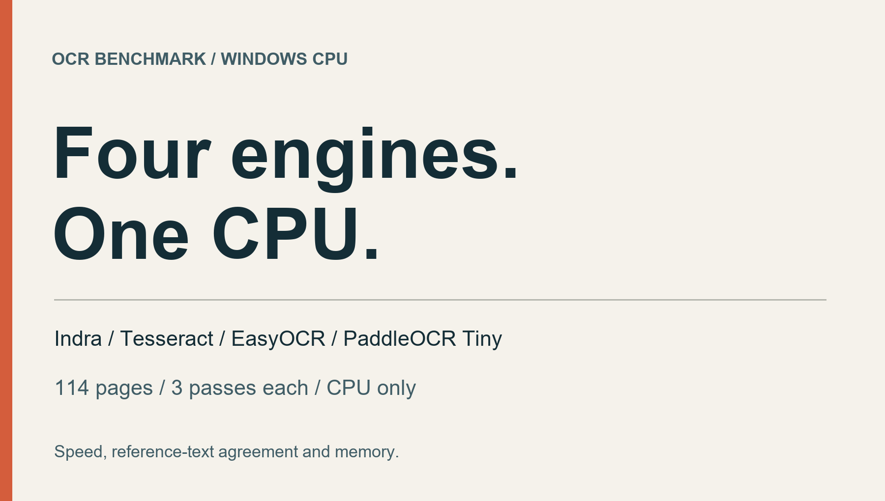
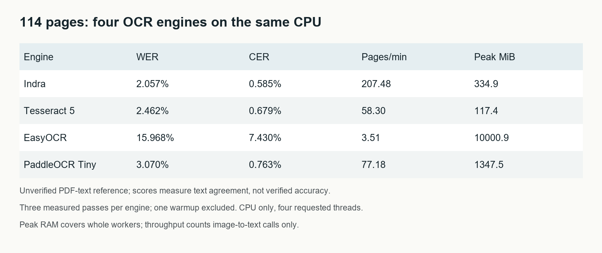

# CPU OCR Benchmark: Indra vs Tesseract, EasyOCR and PaddleOCR

*114 pages, three passes per engine: speed, memory and text agreement on a Windows PC.*

Indra processed this book at **207.48 pages per minute**. PaddleOCR Tiny reached **77.18**, Tesseract **58.30**, and EasyOCR **3.51**. EasyOCR's worker also peaked near **9.8 GiB of RAM**.

*Disclosure: This article was drafted with AI assistance using the project's recorded benchmark results and audit artifacts.*

For CPU OCR on these pages, Indra delivered the highest throughput and closest reference-text agreement; Tesseract used the least RAM. PaddleOCR Tiny ranked second for speed. EasyOCR took the most time and memory in its tested configuration. These findings belong to one book and one PC, with two candidate references that have not been fully independently verified.

Here is the completed four-engine comparison on my Windows PC, including a timing inconsistency that still needs to stay visible.

*Editorial graphic prepared with AI assistance for this benchmark.*

## Same PC, same pages, four configurations

Every engine received the same **114 saved RGB page images at 200 DPI**, rendered from one English book. No engine could read the PDF's embedded text as input. Indra was forced into OCR mode, with headers and footers retained.

The PC had an Intel Core i7-12700K, 20 logical CPUs and approximately 96 GiB of RAM. It used CPU inference throughout. Four inference threads were requested per engine; that setting does not cap every library thread. This is a well-equipped desktop, not evidence of performance on an entry-level or low-memory PC.

The configurations were:

- **Indra 0.3.2:** plain recognized text, forced OCR mode.
- **Tesseract 5.5.3:** English language data, OEM 1, PSM 3.
- **EasyOCR 1.7.2:** CRAFT detection and english_g2 recognition, CPU, greedy decoding, batch size 1, zero data-loader workers. Its default dynamic quantization was requested, and actual quantized Linear/LSTM modules were recorded. It used an isolated PyTorch 2.8.0 CPU environment.
- **PaddleOCR 3.7.0:** the official PP-OCRv6 **Tiny** ONNX detector and recognizer, ONNX Runtime 1.31.0 CPU, four intra-op threads, one inter-op thread and denormal-as-zero enabled. Document orientation, unwarping and line-orientation modules were disabled. This is the Tiny configuration, distinct from the medium model in the earlier experiment.

Each engine had one first-image warmup and three complete measured passes. Engines ran sequentially on the same PC. Throughput uses the median complete-pass duration.

## Read these error rates as text agreement

The reference was extracted separately from the PDF's embedded text layer. **That reference has not been independently verified.** The following word and character error rates therefore measure agreement with that text, rather than established accuracy against verified ground truth.

WER counts substitutions, missing words and extra words relative to the reference word count. CER does the equivalent at character level. Scores pool errors across the book. Case, punctuation, headers and footers count; Unicode NFC, whitespace collapse and Markdown heading-prefix removal are applied consistently.

*Programmatically rendered results, prepared with AI assistance. Same 114 images, three passes per engine, zero execution failures. Lower WER/CER means closer agreement with the unverified reference. RAM covers the whole worker, while throughput counts image-to-text calls.*

The current results were:

- **Indra:** 2.057% WER, 0.585% CER, **207.48 pages/min**, 334.9 MiB peak sampled memory.
- **Tesseract:** 2.462% WER, 0.679% CER, **58.30 pages/min**, 117.4 MiB peak sampled memory.
- **EasyOCR:** 15.968% WER, 7.430% CER, **3.51 pages/min**, 10000.9 MiB peak sampled memory.
- **PaddleOCR Tiny:** 3.070% WER, 0.763% CER, **77.18 pages/min**, 1347.5 MiB peak sampled memory.

Against 60,526 reference words, Indra made **1,245 word edits**, Tesseract **1,490**, EasyOCR **9,665** and Tiny **1,858**. None of the engines had an execution failure. A successful execution still needs its recognition output scored.

## Indra led this run; Tesseract used the least memory

Indra had both the highest throughput and the lowest reference-text error rates in this run. It was approximately **2.69 times as fast as Tiny** and **3.56 times as fast as Tesseract** under the tested integrations.

Tesseract had the smallest sampled memory footprint. Tiny was faster than Tesseract, but had a higher word error rate against this reference. EasyOCR was the slowest and most memory-intensive of these configurations, with the highest measured error rates.

That is a useful result for this workload. It does not establish what these engines will do on handwriting, multilingual scans, receipts or complex layouts. EasyOCR's results apply to the specific configuration above; this was not a search for its best possible tuned setup.

A descriptive paired page-bootstrap interval put Indra's WER difference from Tiny at approximately **-1.351 to -0.690 percentage points**. This used 5,000 resamples and a fixed seed. It describes variation within this book, not performance across independent books or document types.

## The pass times were consistent, but the history matters

All three measured passes completed for every engine:

- **Indra:** 33.73, 32.97, 32.90 seconds.
- **Tesseract:** 117.31, 117.57, 116.69 seconds.
- **EasyOCR:** 1,960.17, 1,943.70, 1,946.20 seconds.
- **PaddleOCR Tiny:** 89.11, 88.48, 88.63 seconds.

Their pass-time coefficients of variation were 1.39%, 0.39%, 0.46% and 0.37%, respectively. Each engine produced identical normalized text across its three current passes.

However, an earlier full-book run measured Indra at **32.38 pages/min**, despite matching model hashes. The original historical run measured 200.57 pages/min, closer to the current 207.48 result. The cross-session timing drift remains unexplained.

I would keep that history beside the result. Three consistent passes support a measurement of the current run; they do not explain a different session or justify a universal speed multiplier. The old medium-Paddle measurements remain separate from this Tiny comparison.

## Timing and RAM have different boundaries

The timed image-to-text calls include image decoding. Tesseract starts a command-line process for every image, so its process startup and model loading are included per page. The Python models remain loaded. Rendering the PDF, initial engine setup, warmup, scoring and writing outputs are excluded from throughput.

Engine setup timings are retained in the detailed report: 0.534 seconds for Indra, 0.042 for Tesseract, 3.559 for EasyOCR and 1.477 for Tiny. These are in-process factory/setup measurements, not guaranteed cold-start latencies. Tesseract still loads its OCR model in each timed CLI call.

CPU and memory were sampled every 100 milliseconds over the entire worker, including loading, warmup, inference, scoring and writes. Summed process-tree RSS can double-count shared memory; sampling can miss brief peaks and short-lived child CPU work. Those measurements have a broader scope than throughput.

## Follow-up: a second candidate reference

A supplied AI-assisted transcription covered all 114 pages and listed uncertain passages on 15 pages. I compared it against the saved OCR outputs without rerunning any engine. These are additional reference-agreement scores, separate from the PDF-text scores above.

| Engine | WER, all 114 pages | WER, excluding 15 flagged pages |
|---|---:|---:|
| Indra | 0.385% | 0.225% |
| Tesseract | 1.069% | 0.888% |
| EasyOCR | 16.895% | 16.749% |
| PaddleOCR Tiny | 4.683% | 4.610% |

The ranking was unchanged. Full-book scoring used the supplied best readings for six uncertainty markers; the 99-page check removed every flagged page for every engine. Neither approach makes the reference verified.

A visual spot-check of pages 2, 52 and 76 found that page 76 used straight apostrophes in the transcription where the image showed curly ones. A separate sensitivity check mapped curly and straight quotes to the same characters on both sides. Full-book WER then measured 0.345% for Indra, 0.910% for Tesseract, 15.567% for EasyOCR and 2.568% for Tiny. This helps expose typography effects; it does not replace the strict scores.

The supplied file has not been independently verified across all pages, and its model/version and generation records were not supplied. Even pages without uncertainty flags can contain transcription errors. Speed and RAM remain the original measurements. The reference scores must not be relabeled as independently verified accuracy.

[Detailed supplemental results](transcription-comparison.md).

## What was checked, and what remains

All **456 saved first-pass predictions** were rescored from text. Input/reference hashes, model hashes, runtime settings, pass sums, medians and throughput calculations were checked. Numerical scores and normalized output hashes were retained for all **12 measured engine passes**.

The project also ran a known-text single-image probe before the book measurement. Indra and Tesseract had zero word/character edits. EasyOCR had 19 word and 37 character edits; Tiny had 3 word and 2 character edits. These checks cover one known passage. They do not substitute for a diverse accuracy dataset.

The software checks pass, but the next accuracy study still needs independently supplied annotations across varied documents. This book's embedded text and the synthetic probe cannot provide that evidence. Training overlap is also unknown.

The review package includes code, aggregate results, configuration provenance, synthetic controls and checksums. It excludes the commercial book, its raw page images, reference text and OCR predictions. Reproducing the book run requires a legally obtained copy matching the recorded input hash. The archive has not yet been publicly hosted.

For this run, Indra was the strongest speed-and-text-agreement result, Tesseract was the lightest on memory, and Tiny ranked second for throughput. For another workload, I would measure the same trade-offs before choosing an engine.

Which document types have changed your own OCR results most?
