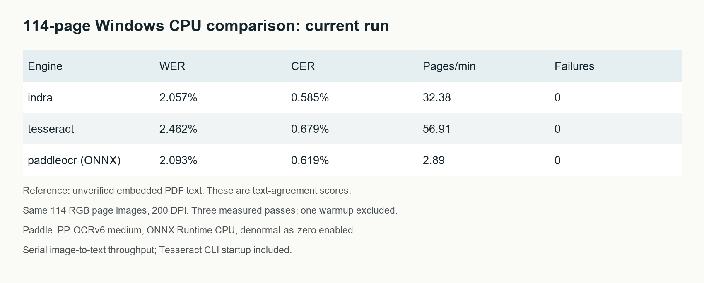

# Indra, Tesseract and PaddleOCR: a reproducible Windows CPU case study

Three OCR engines processed the same 114 page images from one English book. This report compares their text agreement, application throughput, timing variation and sampled resource use. It includes a complete fresh run with PaddleOCR's ONNX CPU backend, separately from the earlier native-runtime measurements.

**Scope:** the reference is the PDF's unverified embedded text, so WER/CER below measure agreement rather than independently verified accuracy. This study does not establish a general OCR winner.

## Current full-book results

| Engine | WER | CER | Pages/min | Failures across three passes |
|---|---:|---:|---:|---:|
| indra | 2.057% | 0.585% | 32.38 | 0 |
| tesseract | 2.462% | 0.679% | 56.91 | 0 |
| paddleocr (ONNX) | 2.093% | 0.619% | 2.89 | 0 |

WER and CER are pooled edit counts divided by reference word/character counts, with case and punctuation significant. Unicode NFC, whitespace collapse and Markdown heading-prefix removal are applied consistently. Headers and footers count. Rates are not averaged across page percentages; 100 minus WER is not a calibrated probability of correct recognition.

## Speed, repeatability and resources

| Engine | Passes (s) | Pass-time CV | Page p50 / p95 (s) | Peak tree RSS (MiB) | Mean busy CPU cores |
|---|---:|---:|---:|---:|---:|
| indra | 212.212 / 211.267 / 210.860 | 0.33% | 1.916 / 2.097 | 314.5 | 3.65 |
| tesseract | 121.083 / 118.612 / 120.200 | 1.04% | 1.102 / 1.404 | 117.3 | 0.92 |
| paddleocr | 2369.675 / 2371.192 / 2352.941 | 0.43% | 21.909 / 26.899 | 3093.4 | 3.59 |

Throughput uses the median of three complete-pass image-to-text durations. It includes image decoding and Tesseract's per-page CLI startup; the Python engines remain loaded. It excludes rendering, model loading, the first-image warmup, scoring and writes. Per-page percentiles above use the first pass. Each engine ran sequentially; engines were not interleaved or tested under an isolated operating system.

Resources were sampled every 100 ms across the entire engine worker, including imports, model loading, warmup, all three passes, scoring and writes. Mean busy cores is sampled CPU seconds divided by that whole-worker wall time. Summed process-tree RSS can double-count shared memory; sampling can miss brief peaks and short-lived child CPU work. Resource and throughput scopes differ.

An earlier 12-page check showed substantial unexplained Indra timing variation (38.77% pass-time CV). Historical and current speeds also differ. The pass durations above expose repeatability in this run; they do not explain cross-session drift or establish a universally stable speed ranking.

## Recognition differences and uncertainty

| Comparison | WER difference (percentage points) | Paired 95% interval |
|---|---:|---:|
| indra minus tesseract | -0.4048 | -0.4986 to -0.3180 |
| indra minus paddleocr | -0.0363 | -0.2664 to 0.1911 |
| tesseract minus paddleocr | 0.3684 | 0.1283 to 0.6101 |

Intervals use 5,000 paired page-bootstrap resamples with seed 20261018. Negative differences favor the left engine. These are descriptive intervals within this one book; pages are not independent books, and these intervals do not justify claims across document types.

## What ran

Windows build 26200, Intel Core i7-12700K, 20 logical CPUs and approximately 95.75 GiB RAM. Four inference threads were requested per engine; this does not cap every library or operating-system thread. Indra 0.3.2 ran in forced OCR mode with furniture enabled and plain page.text output. Tesseract 5.5.3 used English, OEM 1 and PSM 3. PaddleOCR 3.7.0 / PaddleX 3.7.2 used PP-OCRv6 medium detection and recognition, with document orientation, unwarping and text-line orientation disabled.

Paddle used ONNX Runtime 1.31.0, CPUExecutionProvider, four intra-op and one inter-op threads, and session.set_denormal_as_zero=1. Its original cached weights were converted to FP32 ONNX using Paddle2ONNX 2.1.0 with the exact compatible Paddle 3.0.0.dev20250426 converter runtime. Both models passed full ONNX checks. There was no quantization or FP16 conversion. The installed inference PaddlePaddle 3.2.2 environment was not replaced by the isolated converter.

The [ONNX Runtime setting](https://github.com/microsoft/onnxruntime/blob/main/include/onnxruntime/core/session/onnxruntime_session_options_config_keys.h) changes handling of very small floating-point values and can affect numerical outputs. Every measured pass was scored and its normalized output hashes recorded. Neither structural validation nor agreement on tested images proves numerical equivalence for arbitrary inputs. Both OpenCV distributions are installed; the exporter records the actual imported cv2 runtime separately.

## What changed from the earlier measurements

The original native Paddle run achieved 0.84 pages/min on these book images. It did not record weight hashes or full-run resources. That historical result remains in book-results.csv and the earlier statistics; it is not combined with current timings into one ranking.

On three known-text synthetic controls, separate repeated runs measured a 15.61x plain-Paddle-to-ONNX speed ratio with zero text edits in either configuration. These are three renderings of the same 124-word passage, not independent documents. A default-ONNX diagnostic was incomplete; only its first measured image was timed. The supported denormal setting substantially improved the tested configuration, but the exact kernel-level cause and maximum possible speed remain unproven.

Current versus historical first-pass normalized outputs: indra: 114/114 pages match; tesseract: 114/114 pages match; paddleocr: 113/114 pages match. The changed Paddle page is listed in fullbook-quality-check.json. Aggregate edit counts can remain equal despite different text. Historical Paddle weight identity was not recorded, so this compares saved outputs without attributing the difference solely to ONNX or the denormal setting.

## Evidence and reproduction

Dataset manifest SHA256: `baa6cccad7333e9892b22b94990e0cbdb21780aed77ae58047a5ee4d6e065090`. All 342 saved first-pass predictions were rescored from text; input/output hashes, aggregate scores, pass sums, medians and throughput were checked. Numerical scores and normalized output hashes are saved for all nine engine passes. The evidence audit reports whether later outputs match the first pass.

ONNX_REPRO.md gives the tested setup and commands. run_deployment_comparison.py --all-pages creates a fresh, separate 114-page experiment. fullbook-page-stats.csv contains page-level scores and latency. fullbook-comparison.json contains configurations, statistics and measured resources. The release ZIP contains code, permitted aggregate artifacts, original synthetic controls, file checksums and a current environment snapshot.

The commercial book, its page images, embedded text and raw OCR predictions are excluded from the shareable archive. Reproducing this experiment requires a legally obtained PDF matching the recorded hash. A public hosting URL and Medium posting are still separate publication steps.

## Limits and next evidence

The book text layer has not been independently verified. A diverse dataset with independently provided annotations is still needed for broader accuracy claims. Clean synthetic controls cannot supply that evidence. Training overlap, language/domain coverage, scan degradation and full-page reading order are not established by this experiment.

The prepared OmniDocBench annotated-region follow-up could not download data in this execution environment (WinError 10061). No public annotated accuracy scores are claimed. finish_publication.py resumes this separate follow-up when normal network access is available.

The measured results support a reproducible Windows case study and a tested Paddle execution configuration. They do not establish maximum speed, universal numerical equivalence or an industry-wide accuracy ranking.
